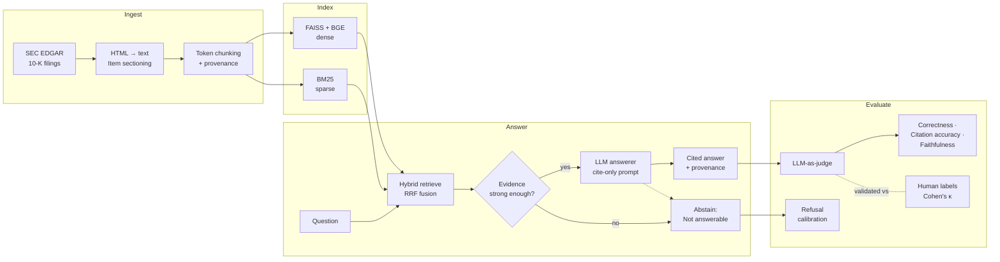

# FinGround

**Faithfulness-first Financial RAG over SEC filings — a system that grounds every
answer in cited evidence, abstains when the filings can't support one, and a
benchmark that measures *hallucination*, not just correctness.**

Most RAG demos optimize "did it get the right answer?" In high-stakes finance the
more dangerous failure is a confident, well-written answer that isn't supported by
the source — or an answer to a question the filings never address. FinGround is
built around that failure mode: answers carry inline `[C#]` citations back to
specific 10-K sections, the system refuses when evidence is weak, and the
evaluation harness scores four dimensions including an explicit, human-validated
**faithfulness / hallucination** metric.

---

## Motivation

- **Hallucination is the tail risk that matters.** A wrong number in a financial
  summary, stated fluently and without a source, is worse than a refusal. FinGround
  rewards abstention over guessing and measures unsupported-claim rate directly.
- **Grounding must be verifiable.** Every retrieved chunk and every citation traces
  to a specific filing, item/section, and character span. "Trust me" is not a
  citation.
- **Evaluation is the product.** The differentiator here isn't the retriever — it's a
  harness that decomposes each answer into atomic claims and checks whether the
  *cited* evidence actually supports them, validated against human labels
  (Cohen's κ).

---

## Architecture



**Pipeline:** ingest → hybrid retrieve → cite-or-refuse → evaluate. The evidence
gate (dense cosine below threshold ⇒ abstain) short-circuits weak questions before
spending a token, and the answerer is separately instructed to abstain when the
excerpts don't support an answer.

---

## Results

Numbers below come from real runs of `scripts/run_benchmark.py` over the 20-question
FinGround gold set, judged by an LLM-as-judge (see **Evaluation methodology**).
Models whose API key was not present at run time are marked **N/A** — never invented.

<!-- RESULTS_TABLE_START -->
| Model | Correctness ↑ | Citation acc ↑ | Hallucination ↓ | Refusal cal ↑ | Latency (s) | $/100q | n | answered |
|---|---|---|---|---|---|---|---|---|
| openai:gpt-4o | N/A | N/A | N/A | N/A | N/A | N/A | 20 | 0 |
| openai:gpt-4o-mini | N/A | N/A | N/A | N/A | N/A | N/A | 20 | 0 |
| anthropic:claude-sonnet-5 | N/A | N/A | N/A | N/A | N/A | N/A | 20 | 0 |
| ollama:llama3 | 0.067 | 0.179 | 0.833 | 0.600 | 60.42 | 0.0000 | 20 | 19 |
<!-- RESULTS_TABLE_END -->

**Charts** (`results/charts/`, regenerate with `make charts`):


**Judge validation** — the whole benchmark is only as trustworthy as its judge, so
we measure judge-vs-human agreement on the committed human labels:

<!-- JUDGE_VALIDATION_START -->
Judge model: `ollama:llama3` · n = 13 examples

| Axis | Raw agreement | Cohen's κ |
|---|---|---|
| Correctness | 76.9% | 0.494 |
| Faithfulness | 92.3% | 0.843 |
<!-- JUDGE_VALIDATION_END -->

> **Run context.** The committed numbers were produced on a machine with only a
> local `ollama:llama3` available (no hosted API keys), so it serves as both the
> answerer and the judge. A stronger hosted judge (GPT-4o / Claude) would raise
> correctness agreement; faithfulness agreement is already strong. Re-run with your
> own keys to populate the hosted-model rows.

---

## Evaluation methodology

Four metrics, each defined in `src/finground/eval/metrics.py` (pure, unit-tested)
and fed by the judge in `eval/judge.py`:

| Metric | What it asks | How it's scored |
|---|---|---|
| **Answer correctness** | Does the answer match the gold answer in meaning? | LLM judge (binary), over answerable questions that were answered. A lexical proxy (`token_f1` + gold-number recall) is also available. |
| **Citation accuracy** | Does each *cited* chunk actually support the answer? | Fraction of cited chunks the judge marks as genuinely supporting. |
| **Faithfulness / hallucination** | Are the answer's claims backed by the cited evidence? | Answer is decomposed into atomic claims; hallucination rate = fraction unsupported by any cited chunk. |
| **Refusal calibration** | Does it abstain iff it should? | Balanced accuracy over the answer/abstain decision (mean of answer-recall and refusal-recall) so "always answer" and "always refuse" both score 0.5. Full confusion matrix retained. |

**LLM-as-judge.** One structured JSON call per answered question returns: the
per-claim support labels (faithfulness), per-citation support labels (citation
accuracy), and a correctness verdict against the gold answer. Refusals are not sent
to the judge — correctness/faithfulness are undefined for an abstention; those are
captured by refusal calibration instead.

**Human validation (essential, not skipped).** `eval/validate_judge.py` runs the
judge over `results/human_labels/seed_labels.jsonl` — self-contained examples
spanning contradictions, wrong numbers, fabricated additions, and correct-but-
mis-cited answers — and reports **Cohen's κ** between judge and human labels for
both correctness and faithfulness.

**Datasets.** The primary set is the FinGround gold set (`results/gold_set.jsonl`),
written to be answerable — or deliberately *not* answerable — from the exact filings
we ingested, so correctness and refusal signals are clean. It includes a
**geoeconomic** category (trade / tariff / export-control exposure drawn from
risk-factor sections). A FinanceBench (`PatronusAI/financebench`) loader anchors to a
public dataset; because its evidence lives in specific filing versions, it is
optionally restricted to the companies in our corpus (coverage caveat below).

---

## Reproducibility

From a fresh clone (Python 3.11):

```bash
make setup                      # venv + install (pins in pyproject.toml)
cp .env.example .env            # add keys you have; missing providers are skipped

# Build the corpus + indexes (no API key needed):
make ingest                     # ~8 latest 10-Ks from SEC EDGAR -> data/chunks.jsonl
make index                      # BM25 + FAISS/BGE indexes

# Try it:
make serve                      # http://localhost:8000  (demo UI + POST /query)

# Evaluate (needs at least one LLM: a hosted key, or local Ollama):
python scripts/make_gold_set.py         # (already committed; regenerate if edited)
python scripts/make_human_labels.py     # (already committed)
make benchmark                          # -> results/results.csv
make charts                             # -> results/charts/*.png
make validate-judge                     # judge vs human labels (Cohen's kappa)

make test                       # unit tests (chunking, retrieval, metrics, answering)
make lint                       # ruff + black + mypy
```

Set `SEC_EDGAR_USER_AGENT` in `.env` to a descriptive string with contact info —
EDGAR requires it. Local models: point `OLLAMA_BASE_URL` at a running Ollama and use
`--models ollama:<name> --judge ollama:<name>`. LLM responses are cached on disk
(`llm_cache/`) so re-runs don't re-bill.

---

## Limitations & honesty

- **Small sample.** 20 gold questions and 13 human labels demonstrate the protocol;
  they are not a statistically powerful benchmark. Kappa on 13 items has wide
  confidence intervals. Scale both before drawing strong conclusions.
- **Single-annotator seed labels.** The human labels are author-adjudicated. Real
  validation needs multiple independent annotators and inter-annotator agreement.
- **Judge bias & self-judging.** An LLM judge shares blind spots with the models it
  scores; using the *same* local model as answerer and judge (as in the committed
  run) is the weakest configuration and is disclosed as such. Prefer a stronger,
  different judge.
- **Data contamination.** LLMs have very likely seen these public 10-Ks in
  pretraining, which can inflate correctness independent of retrieval. Faithfulness
  (claims-vs-cited-evidence) is more robust to this than correctness.
- **Sectioning heuristics.** Item splitting uses a longest-segment heuristic to beat
  the table of contents; unusual filing layouts can mislabel a section (provenance
  still points at real text, just possibly the wrong item label).
- **FinanceBench alignment.** Its gold evidence may reference filing versions we did
  not index, so retrieval can miss the intended passage; treat cross-dataset numbers
  as directional.

---

## How I'd scale this

- **Retrieval:** shard the FAISS index (IVF/HNSW) per company/year; add a
  cross-encoder reranker (`ms-marco-MiniLM`) on the fused candidate pool and distill
  it to keep latency low. Cache query embeddings.
- **Answering:** stream tokens; batch retrieval; move the evidence gate to a small
  calibrated classifier over retrieval features rather than a single cosine
  threshold.
- **Evaluation:** a judge ensemble with majority vote and disagreement routing to
  humans; per-category and per-section slices; bootstrap confidence intervals on
  every metric; track judge drift over time.
- **Data:** incremental EDGAR ingestion (only new filings), 10-Q coverage, table- and
  XBRL-aware chunking so numeric facts keep their row/column context.
- **Serving:** async workers, per-tenant rate limits, and an answer cache keyed by
  (question, index version) with provenance-stable invalidation.

---

## Repository layout

```
src/finground/       ingest · index · retrieve · answer · llm · serve · eval/
scripts/             run_ingest · run_index · run_benchmark · make_charts · make_gold_set · make_human_labels
results/             results.csv · charts/ · judge_validation.json · gold_set.jsonl · human_labels/
demo/                static grounded-QA page hitting /query
tests/               chunking · retrieval provenance · metric math · answering
```

## License

MIT — see [LICENSE](LICENSE).
